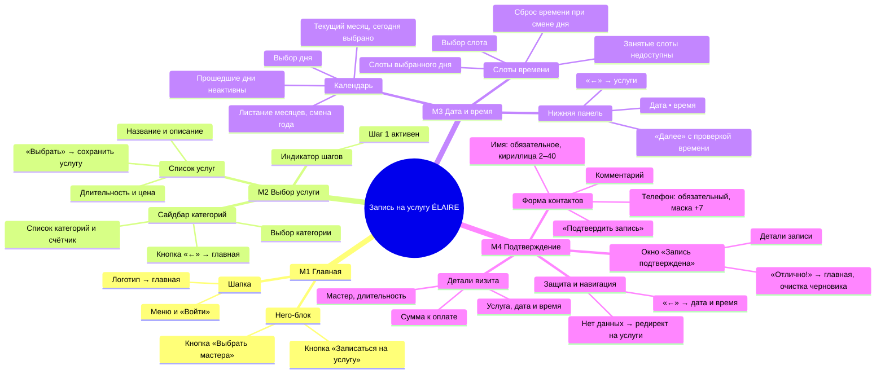

# [Тестирование] Задание 4. Декомпозиция, матрица покрытия, отчёт о тестировании

Объект тестирования — функционал **записи на услугу** сайта салона **ÉLAIRE**
(сборка `frontend-2-complete` из этого репозитория).

| Файл | Что внутри |
|---|---|
| [`README.md`](README.md) | Этот документ: декомпозиция, требования, матрица, тесты, smoke, критерии, отчёт, баг-репорты |
| [`traceability-matrix.xlsx`](traceability-matrix.xlsx) | Матрица покрытия **с выделением жёлтым** + лист с результатами прогона |
| [`feature-map.drawio`](feature-map.drawio) | Карта функционала для [draw.io](https://app.diagrams.net/) (File → Open) |

Содержание:
1. [Декомпозиция и карта функционала](#1-декомпозиция-и-карта-функционала)
2. [Требования по модулям](#2-требования-по-модулям)
3. [Матрица покрытия](#3-матрица-покрытия-traceability-matrix)
4. [Тесты](#4-тесты)
5. [Вход в тестирование (smoke)](#5-вход-в-тестирование-smoke)
6. [Критерии завершения и структура отчёта](#6-критерии-завершения-тестирования-и-структура-отчёта)
7. [Отчёт о тестировании](#7-отчёт-о-тестировании)
8. [Найденные ошибки](#8-найденные-ошибки)
9. [Баг-репорты P1 и P2](#9-баг-репорты-p1-и-p2)

---

## 1. Декомпозиция и карта функционала

Уровни: **модуль → компонент → атомарное действие**. Та же карта — в [`feature-map.drawio`](feature-map.drawio).

---

## 2. Требования по модулям

Требования из задания 1 (FR-1…FR-12) переведены в нумерацию REQ и дополнены новыми,
найденными при обходе карты. 🟨 — **новое требование** или требование, у которого **до этого
задания не было тестов**.

### М1. Главная
| ID | Требование | Источник | |
|---|---|---|---|
| REQ-01 | Система должна открывать экран «Выбор услуги», когда клиент нажимает «Записаться на услугу». | Новое | 🟨 |
| REQ-02 | Система должна открывать выбор мастера, когда клиент нажимает «Выбрать мастера». | Новое | 🟨 |
| REQ-03 | Система должна открывать главную страницу, когда клиент нажимает на логотип ÉLAIRE на любом экране записи. | Новое | 🟨 |

### М2. Выбор услуги
| ID | Требование | Источник | |
|---|---|---|---|
| REQ-04 | Система должна отображать список категорий услуг, когда клиент открывает экран выбора услуги. | FR-1 | |
| REQ-05 | Система должна по умолчанию выделять первую категорию и показывать её услуги, когда экран открывается впервые. | FR-2 | |
| REQ-06 | Система должна выделять категорию и показывать только её услуги, когда клиент кликает по категории. | Новое | 🟨 |
| REQ-07 | Система должна отображать для каждой услуги название, описание, длительность и цену в формате «4 500 ₽». | FR-3 | |
| REQ-08 | Система должна сохранять выбранную услугу и открывать экран «Дата и время», когда клиент нажимает «Выбрать». | FR-4 | |
| REQ-09 | Система должна показывать индикатор шагов с выделенным текущим шагом и отметкой ✓ у пройденных. | Новое | 🟨 |
| REQ-10 | Система должна возвращать клиента на главную, когда он нажимает «←» на экране выбора услуги. | Новое | 🟨 |

### М3. Дата и время
| ID | Требование | Источник | |
|---|---|---|---|
| REQ-11 | Система должна показывать календарь текущего месяца с выбранным по умолчанию сегодняшним днём. | FR-5 | 🟨 |
| REQ-12 | Система должна запрещать выбор дней раньше текущей даты и отображать их неактивными (приглушёнными). | FR-6 | 🟨 |
| REQ-13 | Система должна листать месяцы стрелками «‹» / «›» и менять год при переходе декабрь ↔ январь. | Новое | 🟨 |
| REQ-14 | Система не должна позволять перейти к месяцам раньше текущего. | Новое | 🟨 |
| REQ-15 | Система должна сохранять ровно ту дату, которую выбрал клиент, и подсвечивать её только в её месяце. | Новое | 🟨 |
| REQ-16 | Система должна показывать слоты выбранного дня; занятые слоты недоступны для выбора. | FR-7 | 🟨 |
| REQ-17 | Система должна сбрасывать выбранное время, когда клиент выбирает другой день. | FR-7 | 🟨 |
| REQ-18 | Система должна показывать в нижней панели выбранные дату и время («Пятница, 17 октября 2026 • 12:00»). | Новое | 🟨 |
| REQ-19 | Система должна показывать «Пожалуйста, выберите время» и не переходить дальше, когда время не выбрано. | FR-8 | 🟨 |
| REQ-20 | Система должна возвращать клиента к выбору услуги, когда он нажимает «←» на экране даты. | Новое | 🟨 |
| REQ-21 | Система должна открывать экран даты только с выбранной услугой и показывать её название. | Новое | 🟨 |

### М4. Подтверждение
| ID | Требование | Источник | |
|---|---|---|---|
| REQ-22 | Система должна показывать детали визита: услугу, дату и время, мастера этой услуги, длительность и сумму. | FR-9 | |
| REQ-23 | Система не должна подтверждать запись, когда не заполнено поле «Ваше имя». | FR-10 | |
| REQ-24 | Система не должна подтверждать запись, когда не заполнено поле «Номер телефона». | FR-10 | |
| REQ-25 | Поле «Номер телефона» должно принимать только мобильный номер +7 (9ХХ) ХХХ-ХХ-ХХ (11 цифр) через маску. | Новое (из зад. 3) | 🟨 |
| REQ-26 | Поле «Ваше имя» должно принимать только кириллицу, от 2 до 40 символов. | Новое (из зад. 3) | 🟨 |
| REQ-27 | Система должна показывать окно «Запись подтверждена» с деталями, когда форма заполнена корректно. | FR-11 | |
| REQ-28 | Система должна открывать главную и очищать черновик записи, когда клиент нажимает «Отлично!». | Новое | 🟨 |
| REQ-29 | Система должна перенаправлять на выбор услуги, когда экран подтверждения открыт без услуги, даты или времени. | FR-12 | 🟨 |
| REQ-30 | Система должна возвращать клиента к дате и времени с сохранённым выбором, когда он нажимает «←». | Новое | 🟨 |

---

## 3. Матрица покрытия (traceability matrix)

> **Цветом** (жёлтая заливка) строки выделены в [`traceability-matrix.xlsx`](traceability-matrix.xlsx) —
> GitHub не умеет красить таблицы Markdown, поэтому здесь те же строки отмечены 🟨.

| | ID требования | Формулировка (кратко) | ID теста(ов) | Пробел до задания 4 |
|---|---|---|---|---|
| 🟨 | REQ-01 | «Записаться на услугу» → экран услуг | TC-01, TC-03 | новое требование |
| 🟨 | REQ-02 | «Выбрать мастера» → выбор мастера | **TC-33** | новое требование, новый тест |
| 🟨 | REQ-03 | Логотип → главная | TC-14 | новое требование |
| | REQ-04 | Список категорий | TC-05 | — |
| | REQ-05 | Первая категория по умолчанию | TC-06 | — |
| 🟨 | REQ-06 | Клик по категории: выделение и её услуги | TC-07, TC-08 | новое требование |
| | REQ-07 | Поля услуги и формат цены | TC-09, TC-10 | — |
| | REQ-08 | «Выбрать» сохраняет услугу и ведёт на дату | TC-01, TC-11, TC-12 | — |
| 🟨 | REQ-09 | Индикатор шагов | TC-01, TC-04 | новое требование |
| 🟨 | REQ-10 | «←» на услугах → главная | TC-13 | новое требование |
| 🟨 | REQ-11 | Календарь текущего месяца, сегодня выбрано | **TC-21** | **не было тестов** |
| 🟨 | REQ-12 | Прошедшие дни неактивны и приглушены | **TC-21** | **не было тестов** |
| 🟨 | REQ-13 | Листание месяцев, смена года | **TC-22** | новое требование, новый тест |
| 🟨 | REQ-14 | Нельзя в прошедшие месяцы | **TC-23** | новое требование, новый тест |
| 🟨 | REQ-15 | Сохраняется именно выбранная дата | **TC-24** | новое требование, новый тест |
| 🟨 | REQ-16 | Слоты дня, занятые недоступны | TC-01, **TC-25** | **не было отдельного теста** |
| 🟨 | REQ-17 | Смена дня сбрасывает время | **TC-26** | **не было тестов** |
| 🟨 | REQ-18 | Нижняя панель «дата • время» | TC-01 | новое требование |
| 🟨 | REQ-19 | «Далее» без времени → сообщение | **TC-27** | **не было тестов** |
| 🟨 | REQ-20 | «←» на дате → услуги | **TC-28** | новое требование, новый тест |
| 🟨 | REQ-21 | Экран даты только с выбранной услугой | **TC-29** | новое требование, новый тест |
| | REQ-22 | Детали визита, мастер услуги | TC-01, TC-30 | — |
| | REQ-23 | Имя обязательно | TC-20 | — |
| | REQ-24 | Телефон обязателен | TC-02, TC-20 | — |
| 🟨 | REQ-25 | Формат телефона +7, маска | TC-15, TC-16, TC-17, TC-20 | новое требование |
| 🟨 | REQ-26 | Имя: кириллица 2–40 | TC-18, TC-19 | новое требование |
| | REQ-27 | Успешное подтверждение → окно | TC-01, TC-20 | — |
| 🟨 | REQ-28 | «Отлично!» → главная, очистка | TC-01, **TC-31** | новое требование |
| 🟨 | REQ-29 | Нет данных → редирект | **TC-32** | **не было тестов** |
| 🟨 | REQ-30 | «←» с подтверждения сохраняет выбор | **TC-34** | новое требование, новый тест |

**Итог покрытия:** 30 требований, 30 покрыты тестами (100 %). Пробелов до задания 4 —
6 требований из задания 1 без тестов (REQ-11, 12, 16, 17, 19, 29) и 16 новых требований.
Для них дописаны тесты **TC-21…TC-34**.

---

## 4. Тесты

### 4.1. Тесты из заданий 2 и 3 (перенумерованы в единую сквозную нумерацию)

| ID | Тест | Откуда |
|---|---|---|
| TC-01 | Успешная запись через весь сценарий | Зад. 2.1, тест-кейс TC-01 |
| TC-02 | Подтверждение с пустым полем «Номер телефона» | Зад. 2.1, тест-кейс TC-02 |
| TC-03 … TC-14 | Пункты 1–12 чек-листа «Выбор услуги» (по порядку) | Зад. 2.1, чек-лист |
| TC-15 | Телефон: классы эквивалентности P1–P10 | Зад. 3.1 |
| TC-16 | Телефон: граничные значения длины BV-P1–P3 (10/11/12 цифр) | Зад. 3.1 |
| TC-17 | Телефон: граница мобильного кода BV-P4–P6 | Зад. 3.1 |
| TC-18 | Имя: классы эквивалентности N1–N11 | Зад. 3.1 |
| TC-19 | Имя: граничные значения длины BV-N1–N8 (0/1/2/3/39/40/41) | Зад. 3.1 |
| TC-20 | Таблица решений R1–R7 для подтверждения записи | Зад. 3.2 |

Полный текст этих тестов — в [`testing-2-practice`](../testing-2-practice) и [`testing-3-practice`](../testing-3-practice).

### 4.2. Новые тесты для закрытия пробелов

Общее предусловие для TC-21…TC-30: открыт сайт ÉLAIRE, выбрана услуга «Стрижка женская»,
открыт экран «Дата и время». «Сегодня» в приложении — **17 октября 2026**.

| ID | Название | Шаги | Ожидаемый результат |
|---|---|---|---|
| **TC-21** | Календарь по умолчанию и прошедшие дни | 1. Открыть экран даты. 2. Осмотреть дни 1–16 октября. 3. Кликнуть по 10 октября. | Показан октябрь 2026, выбран 17-й; дни 1–16 приглушены (визуально неактивны); клик по 10-му ничего не выбирает |
| **TC-22** | Листание и смена года | 1. Нажать «›» 3 раза. 2. Нажать «‹» 1 раз. | Ноябрь → Декабрь 2026 → Январь **2027**; затем снова Декабрь 2026 |
| **TC-23** | Нельзя в прошедшие месяцы | 1. На октябре 2026 нажать «‹». | Стрелка «‹» неактивна, календарь остаётся на октябре |
| **TC-24** | Сохраняется выбранная дата | 1. Выбрать 20 октября, слот 10:00. 2. Нажать «‹» (сентябрь). 3. Нажать «Далее». | В сентябре 20-е **не** подсвечено; на экране подтверждения дата **20 октября 2026, 10:00** |
| **TC-25** | Слоты и занятые слоты | 1. Выбрать 17 октября. 2. Кликнуть по занятому слоту 11:00. 3. Кликнуть по 10:00. | Занятые слоты визуально отличаются, клик по 11:00 ничего не выбирает; 10:00 выбирается |
| **TC-26** | Смена дня сбрасывает время | 1. Выбрать 20 октября 10:00. 2. Выбрать 21 октября. | Нижняя панель: «Среда, 21 октября 2026 • время не выбрано», слот не выделен |
| **TC-27** | «Далее» без времени | 1. Не выбирая время, нажать «Далее». | Сообщение «Пожалуйста, выберите время», остаёмся на экране даты |
| **TC-28** | «←» на экране даты | 1. Нажать «←». | Открыт экран «Выбор услуги» |
| **TC-29** | Экран даты без услуги | Предусловие: черновик записи очищен. 1. Открыть `booking.html` напрямую. | Редирект на «Выбор услуги» **или** сообщение «Сначала выберите услугу»; на экране даты видно название выбранной услуги |
| **TC-30** | Мастер услуги в деталях | 1. Выбрать «Стрижка женская», дату, время. 2. Нажать «Далее». | В строке «Мастер» — мастер по волосам (не мастер маникюра) |
| **TC-31** | «Отлично!» | 1. Подтвердить корректную запись. 2. Нажать «Отлично!». | Открыта главная, черновик записи (`localStorage["elair-booking"]`) удалён |
| **TC-32** | Прямой заход на подтверждение | Предусловие: черновик очищен. 1. Открыть `confirmation.html`. | Редирект на «Выбор услуги» |
| **TC-33** | «Выбрать мастера» | 1. На главной нажать «Выбрать мастера». | Открыт экран выбора мастера |
| **TC-34** | «←» с подтверждения | 1. Выбрать 20 октября 10:00, «Далее». 2. Нажать «←». | Открыт экран даты, выбраны 20 октября и 10:00 |

---

## 5. Вход в тестирование (smoke)

Минимальный набор — проходится за 5–10 минут перед полным тестированием:

| № | Smoke-проверка | Ожидаемый результат |
|---|---|---|
| S-1 | Открыть главную страницу | Страница загружается, в консоли нет ошибок JS |
| S-2 | Нажать «Записаться на услугу» | Открыт экран «Выбор услуги» со списком категорий и услуг |
| S-3 | Выбрать любую услугу | Открыт экран «Дата и время», отрисован календарь и слоты |
| S-4 | Выбрать день и свободный слот | Дата и время отображаются в нижней панели |
| S-5 | Нажать «Далее» | Открыт экран «Подтверждение», детали визита заполнены |
| S-6 | Ввести имя и телефон, нажать «Подтвердить запись» | Открыто окно «Запись подтверждена» |
| S-7 | Нажать «Отлично!» | Открыта главная страница |

**Готов начинать полное тестирование, если** все 7 smoke-проверок пройдены, сквозной сценарий
от главной до окна подтверждения выполняется без блокирующих ошибок, а в консоли браузера нет
ошибок JavaScript. Если падает хотя бы одна проверка — сборка возвращается разработке без полного прогона.

**Результат smoke в этом прогоне:** 7 из 7 пройдено → полное тестирование начато.

---

## 6. Критерии завершения тестирования и структура отчёта

### Критерии завершения
1. Выполнено 100 % запланированных тестов (TC-01…TC-34); заблокированных тестов нет.
2. Покрытие требований — 100 % (каждое REQ связано хотя бы с одним выполненным тестом).
3. Нет открытых дефектов серьёзности **Blocker / Critical** и приоритета **P1**.
4. Все исправленные дефекты перепроверены (re-test), выполнен регресс затронутых модулей.
5. Открытые Minor/Trivial дефекты задокументированы и согласованы с владельцем продукта.
6. Доля пройденных тестов ≥ 95 %.
7. Отчёт о тестировании согласован с командой.

### Структура итогового отчёта
1. **Общие сведения** — объект, версия сборки, период, тестировщик.
2. **Окружение** — ОС, браузер, способ запуска, тестовые данные.
3. **Объём тестирования** — что тестировалось и что нет (вне scope).
4. **Метрики** — тестов всего / Passed / Failed / Blocked / Not run, % прохождения, % покрытия требований, дефекты по серьёзности и приоритету, плотность дефектов по модулям.
5. **Результаты по модулям** — таблица модуль → тестов → прошло → дефекты.
6. **Основные дефекты** — список с ID, серьёзностью и приоритетом.
7. **Риски** — что может пойти не так в продакшене.
8. **Выводы и рекомендация** — готовность к релизу, что исправить в первую очередь.

---

## 7. Отчёт о тестировании

### 7.1. Общие сведения
| | |
|---|---|
| Объект | Функционал записи на услугу, сайт ÉLAIRE |
| Сборка | `frontend-2-complete` (репозиторий learn-web-dev, ветка `main`) |
| Дата прогона | 12.11.2026 |
| Вид тестирования | Функциональное, ручное (black-box) + проверки в DevTools |

### 7.2. Окружение
| | |
|---|---|
| ОС | Windows 11 Pro |
| Браузер | Google Chrome (актуальная версия на дату прогона) |
| Запуск | Локальный статический сервер `python -m http.server` на `127.0.0.1` |
| «Сегодня» в приложении | 17.10.2026 — зашито в `SERVER_DATA.today` (имитация сервера) |
| Данные | Встроенные данные услуг и слотов; `localStorage` очищался перед каждым тестом |

### 7.3. Объём
**В scope:** модули М1–М4 (30 требований). **Вне scope:** меню шапки (Услуги/Мастера/Отзывы/Контакты),
кнопка «Войти», адаптивная вёрстка, кроссбраузерность, производительность, доступность.

### 7.4. Метрики

| Метрика | Значение |
|---|---|
| Тестов всего | 34 |
| Passed | 19 |
| Failed | 15 |
| Blocked / Not run | 0 / 0 |
| % прохождения | **56 %** |
| Покрытие требований тестами | 30 / 30 — **100 %** |
| Требований без дефектов | 19 / 30 |
| Дефектов всего | **11** |
| — Critical | 2 |
| — Major | 4 |
| — Minor | 4 |
| — Trivial | 1 |
| — P1 / P2 / P3 / P4 | 3 / 3 / 4 / 1 |

### 7.5. Результаты по модулям

| Модуль | Тестов | Passed | Failed | Дефекты |
|---|---|---|---|---|
| М1. Главная | 3 (TC-03, TC-14, TC-33) | 2 | 1 | BUG-06 |
| М2. Выбор услуги | 10 (TC-04…TC-13) | 10 | 0 | BUG-11 (Trivial, замечание) |
| М3. Дата и время | 9 (TC-21…TC-29) | 5 | 4 | BUG-01, BUG-07, BUG-08, BUG-09 |
| М4. Подтверждение | 12 (TC-01, TC-02, TC-15…TC-20, TC-30…TC-32, TC-34) | 2 | 10 | BUG-02, BUG-03, BUG-04, BUG-05, BUG-10 |
| **Итого** | **34** | **19** | **15** | **11** |

Полная таблица «тест → результат → баг» — лист «Тесты и результаты» в [`traceability-matrix.xlsx`](traceability-matrix.xlsx).

| Тест | Результат | Баг | | Тест | Результат | Баг |
|---|---|---|---|---|---|---|
| TC-01 | ❌ Failed | BUG-05 | | TC-18 | ❌ Failed | BUG-04 |
| TC-02 | ❌ Failed | BUG-02 | | TC-19 | ❌ Failed | BUG-04 |
| TC-03…TC-08 | ✅ Passed | — | | TC-20 | ❌ Failed | BUG-02, BUG-03 |
| TC-09 | ✅ Passed | BUG-11 (замечание) | | TC-21 | ❌ Failed | BUG-07 |
| TC-10…TC-14 | ✅ Passed | — | | TC-22 | ✅ Passed | — |
| TC-15 | ❌ Failed | BUG-03 | | TC-23 | ❌ Failed | BUG-08 |
| TC-16 | ❌ Failed | BUG-03 | | TC-24 | ❌ Failed | BUG-01 |
| TC-17 | ❌ Failed | BUG-03 | | TC-25…TC-28 | ✅ Passed | — |
| | | | | TC-29 | ❌ Failed | BUG-09 |
| | | | | TC-30 | ❌ Failed | BUG-05 |
| | | | | TC-31, TC-32 | ✅ Passed | — |
| | | | | TC-33 | ❌ Failed | BUG-06 |
| | | | | TC-34 | ❌ Failed | BUG-10 |

В таблице решений (TC-20) пройдено только правило R1 (корректные данные); R2, R3, R5, R6, R7 — провалены:
запись подтверждается при любом содержимом полей.

### 7.6. Риски
- Клиенты записываются на прошедшие даты и не на те даты, что выбрали (BUG-01), — неявки и конфликты в расписании.
- Записи без контактов или с мусором в телефоне (BUG-02, BUG-03) — с клиентом невозможно связаться.
- Неверный мастер в подтверждении (BUG-05) — клиент приходит не к тому специалисту.
- «Сегодня» зашито в код (17.10.2026); при реальной дате позже этой даты календарь предлагает уже прошедшие дни.
  Это ограничение имитации сервера, но при переходе на реальный backend проверку нужно повторить.

### 7.7. Выводы и рекомендация
Smoke и основной сценарий проходят, экран «Выбор услуги» работает без ошибок. Однако открыты
**2 Critical и 1 Major с приоритетом P1** — критерий завершения №3 не выполнен.

**Рекомендация: функционал к релизу не готов.** В первую очередь исправить BUG-01, BUG-02, BUG-03,
затем BUG-04…BUG-06, после чего провести повторное тестирование (re-test) и регресс модулей М3 и М4.

---

## 8. Найденные ошибки

Формат: **Название — шаги — фактический результат — ожидаемый результат.**

| ID | Серьёзность / приоритет | Название | Шаги | Фактический результат | Ожидаемый результат |
|---|---|---|---|---|---|
| BUG-01 | Critical / P1 | После листания месяцев сохраняется другая дата — можно записаться на прошедшую | Выбрать 20 окт, 10:00 → «‹» (сентябрь) → «Далее» | Подтверждение на **20 сентября 2026, 10:00**; в сентябре и ноябре подсвечено «20» | Сохраняется 20 октября; подсветка только в октябре |
| BUG-02 | Critical / P1 | Запись подтверждается с пустыми именем и телефоном | Экран подтверждения → оставить поля пустыми → «Подтвердить запись» | Открыто окно «Запись подтверждена» | Запись не создаётся, ошибки у пустых полей |
| BUG-03 | Major / P1 | Поле телефона без маски принимает буквы, спецсимволы и неполный номер | Ввести `abc!@#привет` или `+7 (912) 345-67-8` → «Подтвердить запись» | Значения вводятся, запись подтверждается | Маска +7, только цифры, 11 цифр, иначе ошибка |
| BUG-04 | Major / P2 | Поле имени принимает цифры, латиницу, 1 символ | Ввести `123` (или `A`) → «Подтвердить запись» | Запись подтверждается | Ошибка «Имя: только русские буквы, 2–40 символов» |
| BUG-05 | Major / P2 | В деталях записи всегда мастер «Алиса Розен» | Выбрать «Стрижка женская» → дата, время → «Далее» | Мастер «Алиса Розен» (мастер ногтевой эстетики) — и в деталях, и в окне подтверждения | Мастер, оказывающий выбранную услугу |
| BUG-06 | Major / P2 | Кнопка «Выбрать мастера» не работает | Главная → «Выбрать мастера» | Ничего не происходит | Открывается выбор мастера |
| BUG-07 | Minor / P3 | Прошедшие дни выглядят как доступные | Экран даты, осмотреть 1–16 октября | Тот же цвет и курсор-указатель, что у доступных; клик не срабатывает | Дни приглушены, курсор «недоступно» |
| BUG-08 | Minor / P3 | Можно листать в прошедшие месяцы | На октябре 2026 нажать «‹» | Открывается сентябрь (все дни неактивны) | «‹» неактивна на текущем месяце |
| BUG-09 | Minor / P3 | Экран даты открывается без услуги; услуга на нём не показана | Очистить черновик → открыть `booking.html` → выбрать время → «Далее» | Можно выбрать время, после «Далее» — молча возвращает в каталог | Сразу редирект или сообщение «Сначала выберите услугу»; название услуги на экране |
| BUG-10 | Minor / P3 | «←» с подтверждения сбрасывает выбор | Выбрать 20 окт, 10:00 → «Далее» → «←» | Выбрано 17 октября, время не выбрано | Выбраны 20 октября и 10:00 |
| BUG-11 | Trivial / P4 | Одинаковое описание у всех услуг маникюра | Экран услуг → «Маникюр и педикюр» | У всех 5 услуг «Идеальная чистота линий, сертифицированные премиум препараты.» | У каждой услуги своё описание |

---

## 9. Баг-репорты P1 и P2

Общее окружение: Windows 11 Pro; Google Chrome; сборка `frontend-2-complete`, локальный сервер
`127.0.0.1`; «сегодня» в приложении — 17.10.2026; перед каждым тестом очищен `localStorage`.

### BUG-01. После листания месяцев сохраняется другая дата — можно записаться на прошедшую дату

| | |
|---|---|
| **Серьёзность** | Critical |
| **Приоритет** | P1 |
| **Модуль** | М3. Дата и время → Календарь |
| **Требования** | REQ-14, REQ-15 |
| **Тест** | TC-24 |

**Предусловия:** выбрана услуга «Стрижка женская», открыт экран «Дата и время» (октябрь 2026).

**Шаги:**
1. Кликнуть по 20 октября.
2. Выбрать слот 10:00. В нижней панели: «Вторник, 20 октября 2026 • 10:00».
3. Нажать «‹» — открывается сентябрь 2026.
4. Нажать «Далее».

**Фактический результат:** на экране подтверждения и в окне «Запись подтверждена» —
**«20 сентября 2026 в 10:00»**, то есть дата в прошлом. В `localStorage` сохранено
`"date":{"day":20,"month":8,"year":2026}`. Кроме того, после шага 3 в сентябре (и в ноябре при «›»)
подсвечено число 20, хотя выбрано 20 октября, а нижняя панель по-прежнему показывает октябрь.

**Ожидаемый результат:** сохраняется выбранная клиентом дата (20 октября 2026); подсветка — только
в октябре; записаться на дату раньше «сегодня» невозможно.

**Дополнительные данные:**
- Скриншот 1 — календарь сентября с подсвеченным «20» и нижней панелью «20 октября».
- Скриншот 2 — экран подтверждения с датой «20 сентября 2026 в 10:00».
- Значение `localStorage["elair-booking"]` после шага 4.
- Вероятная причина: `booking.js` — при сохранении и подсветке используется месяц, открытый
  в календаре (`currentMonth`), а не месяц выбранного дня.

**Обоснование:** Critical — нарушена основная функция (запись создаётся на неверную, в т.ч. прошедшую дату),
последствия для бизнеса — неявки и конфликты расписания. P1 — воспроизводится стабильно на обычном
действии пользователя (листание календаря), исправить в первую очередь.

---

### BUG-02. Запись подтверждается с пустыми полями «Ваше имя» и «Номер телефона»

| | |
|---|---|
| **Серьёзность** | Critical |
| **Приоритет** | P1 |
| **Модуль** | М4. Подтверждение → Форма контактов |
| **Требования** | REQ-23, REQ-24 |
| **Тесты** | TC-02, TC-20 (R3, R5, R7) |

**Предусловия:** пройдены шаги 1–2 сценария, открыт экран «Подтверждение записи», поля формы пустые.

**Шаги:**
1. Не заполнять «Ваше имя» и «Номер телефона».
2. Нажать «Подтвердить запись».

**Фактический результат:** открывается окно «Запись подтверждена». У полей нет признака обязательности
(`required`), ошибки не показываются.

**Ожидаемый результат:** запись не подтверждается, оба поля подсвечены, подсказки «Введите имя» и
«Введите номер телефона».

**Дополнительные данные:** скриншот пустой формы и открытого окна «Запись подтверждена»; в DevTools →
Elements у `#name` и `#phone` нет атрибута `required`; в Console ошибок нет.

**Обоснование:** Critical — создаются записи, по которым невозможно идентифицировать и связаться
с клиентом. P1 — затрагивает каждую запись, исправление простое.

---

### BUG-03. Поле «Номер телефона» без маски принимает буквы, спецсимволы и неполный номер

| | |
|---|---|
| **Серьёзность** | Major |
| **Приоритет** | P1 |
| **Модуль** | М4. Подтверждение → Форма контактов |
| **Требования** | REQ-25 |
| **Тесты** | TC-15, TC-16, TC-17, TC-20 (R2, R6) |

**Предусловия:** открыт экран «Подтверждение записи».

**Шаги:**
1. В «Ваше имя» ввести «Анна».
2. В «Номер телефона» ввести `abc!@#привет`.
3. Нажать «Подтвердить запись».
4. Повторить с номером `+7 (912) 345-67-8` (10 цифр).

**Фактический результат:** маска `+7` не появляется; любые символы вводятся; в обоих случаях запись подтверждается.

**Ожидаемый результат:** маска `+7 (___) ___-__-__`, вводятся только цифры, номер из 11 цифр с мобильным
кодом 9ХХ; иначе — ошибка «Введите номер в формате +7 (999) 123-45-67», запись не создаётся.

**Дополнительные данные:** скриншот поля со значением `abc!@#привет`; скриншот окна подтверждения;
у `#phone` — `type="tel"` без `pattern` и `maxlength`.

**Обоснование:** Major — сценарий не падает, но запись содержит некорректный контакт; P1 — массовый
дефект, напрямую влияет на связь с клиентами.

---

### BUG-04. Поле «Ваше имя» принимает цифры, латиницу и один символ

| | |
|---|---|
| **Серьёзность** | Major |
| **Приоритет** | P2 |
| **Модуль** | М4. Подтверждение → Форма контактов |
| **Требования** | REQ-26 |
| **Тесты** | TC-18, TC-19 |

**Шаги:** 1. В «Ваше имя» ввести `123`. 2. В телефон — `+7 (912) 345-67-89`. 3. «Подтвердить запись».
Повторить с `Anna` и `А`.

**Фактический результат:** во всех случаях запись подтверждается.

**Ожидаемый результат:** ошибка «Имя должно содержать только русские буквы, от 2 до 40 символов».

**Дополнительные данные:** скриншот формы с `123` и окна подтверждения.

**Обоснование:** Major — некорректные данные в записи; P2 — телефон (главный канал связи) важнее, имя исправить следом.

---

### BUG-05. В деталях записи всегда указан мастер «Алиса Розен»

| | |
|---|---|
| **Серьёзность** | Major |
| **Приоритет** | P2 |
| **Модуль** | М4. Подтверждение → Детали визита, окно подтверждения |
| **Требования** | REQ-22 |
| **Тесты** | TC-01, TC-30 |

**Шаги:** 1. Выбрать «Стрижки и укладки» → «Стрижка женская». 2. Выбрать 20 октября, 10:00. 3. «Далее».
4. Заполнить форму, «Подтвердить запись».

**Фактический результат:** в «Детали вашего визита» и в окне «Запись подтверждена» — «Мастер: Алиса Розен»
(на главной она указана как «Мастер ногтевой эстетики»). Для любой услуги мастер одинаковый.

**Ожидаемый результат:** мастер, который оказывает выбранную услугу (для стрижки — мастер по волосам).

**Дополнительные данные:** скриншоты деталей визита для услуг из разных категорий; в `confirmation.html`
значение «Алиса Розен» прописано статически.

**Обоснование:** Major — клиент получает неверную информацию о визите; P2 — основной поток не блокирован,
но дефект виден в каждой записи.

---

### BUG-06. Кнопка «Выбрать мастера» на главной не работает

| | |
|---|---|
| **Серьёзность** | Major |
| **Приоритет** | P2 |
| **Модуль** | М1. Главная → Hero-блок |
| **Требования** | REQ-02 |
| **Тест** | TC-33 |

**Шаги:** 1. Открыть главную. 2. Нажать «Выбрать мастера».

**Фактический результат:** ничего не происходит, страница не меняется, ошибок в консоли нет.

**Ожидаемый результат:** открывается экран выбора мастера (альтернативный путь записи).

**Дополнительные данные:** видеозапись клика; в `home.js` нет обработчика для `.cta-master`.

**Обоснование:** Major — недоступен второй сценарий записи; P2 — основной путь через услугу работает.
